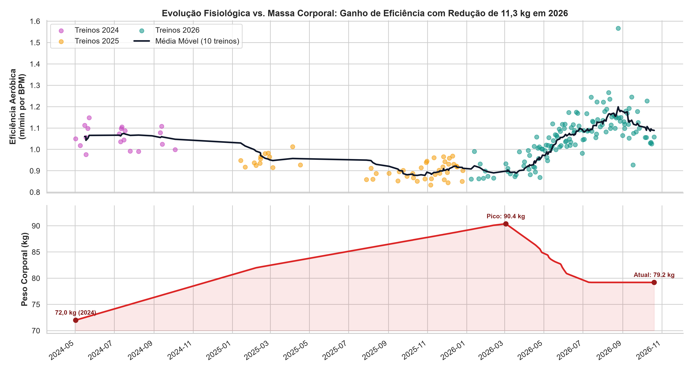
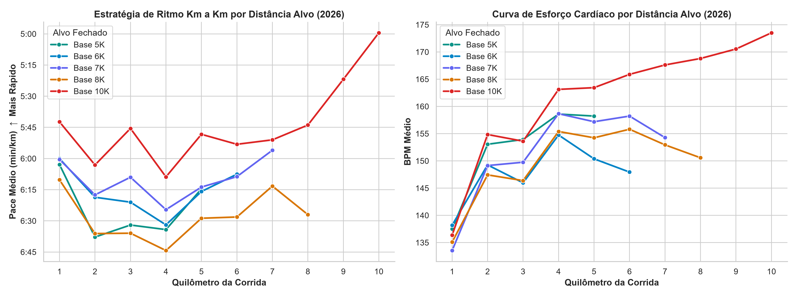
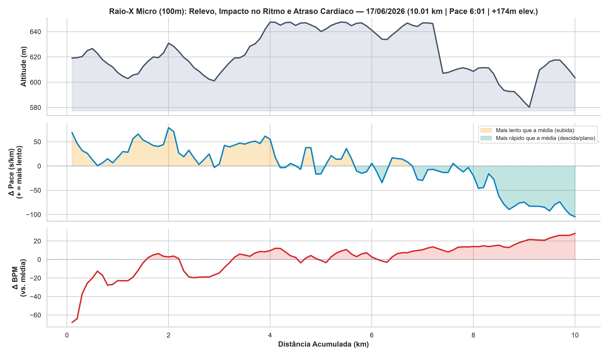
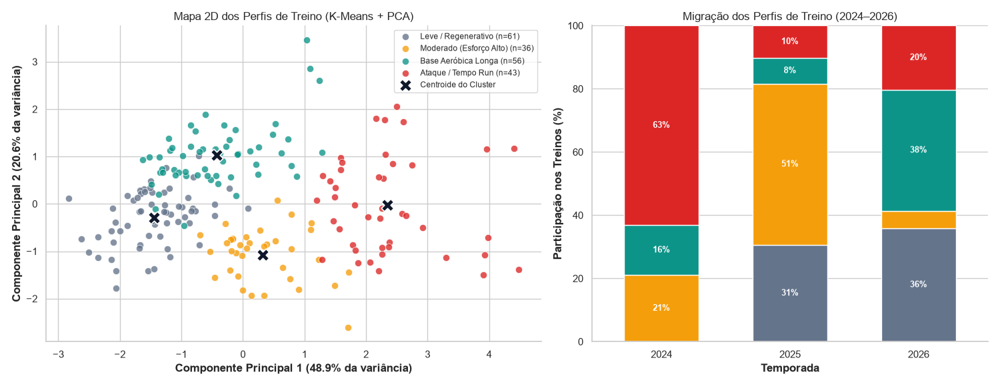

# 🏃‍♂️ Telemetria de Corrida (2024–2026): Engenharia de Dados, Fisiologia do Relevo e Clusterização

Projeto *end-to-end* de Ciência de Dados construído a partir de dados brutos exportados do **Huawei Health** (2024 a 2026). O pipeline transforma arquivos JSON complexos de sensores vestíveis em três bases analíticas sincronizadas — **Macro (sessão)**, **Meso (quilômetro)** e **Micro (fatias de 100 m)** — para investigar evolução aeróbica, impacto da variação de massa corporal, custo biomecânico de inclinação e perfis de treinamento via Machine Learning não supervisionado.

---

## 🎯 Perguntas de Negócio e Fisiologia Respondidas

1. **Evolução Longitudinal:** Como a retomada de consistência em 2026 e a perda de **11,3 kg** (de `90,5 kg` para `79,2 kg`) deslocaram a relação entre ritmo e frequência cardíaca?
2. **Tática de Prova:** Como a gestão de esforço (*split* positivo vs. negativo) muda conforme a distância-alvo fechada (`Base 5K`, `6K`, `7K`, `8K` e `10K`)?
3. **Física do Relevo e Inércia Cardíaca:** Qual é a penalidade real em segundos/km e cadência em diferentes faixas de inclinação, e qual o atraso (*cardiac lag*) entre o esforço da subida e a resposta do batimento?
4. **Descoberta de Perfis de Treino:** Um algoritmo não supervisionado (**K-Means**) consegue identificar automaticamente os tipos de sessão e a mudança de fase fisiológica entre 2024, 2025 e 2026 sem receber rótulos de ano ou peso?

---

## 🏗️ Arquitetura do Pipeline ETL (`src/etl_telemetria_huawei.py`)

Os dados brutos do relógio chegam como séries temporais irregulares (`tp=h-r`, `tp=s-r`, `tp=alti`, `tp=rs`). O script de ETL realiza:

* **Sincronização em 3 Escalas:** Ancora os cortes nos *splits* oficiais do relógio (`partTimeMap`) e interpola sensores para gerar:
  * `df_corridas.csv`: Visão macro consolidada por sessão (**227 sessões**).
  * `df_por_km.csv`: Visão meso com splits quilômetro a quilômetro.
  * `df_por_100m.csv`: Visão micro fatiada a cada 100 metros com variáveis defasadas de inclinação (`inclinacao_lag1_pct` e `inclinacao_lag2_pct`) para capturar inércia cardíaca.
* **Saneamento Guiado por Domínio:**
  * Remoção de atividades registradas incorretamente (ex.: sessões de ciclismo identificadas por anomalias de cadência e horário).
  * Filtro de corridas válidas de rua (`distancia_km >= 2.0` e `pace_dec < 8.0 min/km`, separando corrida de caminhada).
  * Interpolação linear (`np.interp`) do histórico de pesagens para preencher séries contínuas de `peso_kg` sem *data leakage* futuro.
* **Privacidade (LGPD):** Coordenadas geográficas brutas (latitude/longitude) são descartadas durante a extração, mantendo apenas métricas fisiológicas, cadência e variação altimétrica relativa.

---

## 📊 Principais Descobertas

### 1. Evolução Aeróbica vs. Massa Corporal (2024–2026)
A análise longitudinal evidencia três fases distintas: atividade intensa em 2024, destreinamento e ganho de massa em 2025 (pico de `90,5 kg`), e retomada estruturada em 2026 com queda contínua para `79,2 kg` e ganho expressivo de eficiência aeróbica (`m/min por BPM`).



---

### 2. Estratégia Km a Km e Gestão de *Split*
Em 2026, as distâncias-alvo fechadas concentram os treinos estruturados. Enquanto provas curtas (`Base 5K` e `Base 6K`) apresentam leve desaceleração na segunda metade (`+7 s/km` e `+4 s/km`) devido à topografia inicial do percurso, treinos longos apresentam *split* negativo consistente (`-7 s/km` na `Base 8K` e `-20 s/km` na `Base 10K`).



---

### 3. Física do Relevo, Cadência e Atraso Cardíaco (Escala 100 m)
A análise de mais de 10.900 trechos válidos de 100 m quantificou o custo biomecânico do terreno e comprovou o *cardiac lag* (o pico de BPM ocorre entre 100 m e 200 m após o topo da elevação):

| Faixa de Inclinação | Trechos (100 m) | Pace Médio | Δ Pace vs. Média Sessão | BPM Médio | Cadência Média |
| :--- | :---: | :---: | :---: | :---: | :---: |
| **Descida Forte (`< -4%`)** | 1.382 | `6:08/km` | `-23,6 s/km` | 152,4 bpm | 164,6 spm |
| **Descida Leve (`-4%` a `-1,5%`)** | 2.726 | `6:09/km` | `-16,3 s/km` | 151,4 bpm | 164,3 spm |
| **Plano (`-1,5%` a `+1,5%`)** | 3.551 | `6:11/km` | `-4,8 s/km` | 153,6 bpm | 164,1 spm |
| **Subida Leve (`+1,5%` a `+3,5%`)** | 1.516 | `6:34/km` | `+8,8 s/km` | 157,4 bpm | 162,0 spm |
| **Subida Moderada (`+3,5%` a `+6%`)** | 1.395 | `6:43/km` | `+16,2 s/km` | 157,9 bpm | 160,6 spm |
| **Subida Forte (`> +6%`)** | 392 | `6:59/km` | `+32,5 s/km` | 159,7 bpm | 159,6 spm |

> **Insight Biomecânico:** Sair do plano para subidas acima de `+6%` impõe uma penalidade média de **~37 s/km** e reduz a cadência em **4,5 passos/min**.



---

### 4. Clusterização de Perfis de Treino (K-Means + PCA)
Aplicando `StandardScaler` e **K-Means ($K = 4$)** sobre 5 variáveis fisiológicas (`distancia_km`, `pace_dec`, `bpm_medio`, `pct_tempo_bpm_165+`, `deriva_cardiaca`), o modelo identificou quatro perfis distintos — com **69,4% da variância total** preservada nos dois primeiros componentes do PCA (**PC1 = 48,9%** Intensidade; **PC2 = 20,6%** Volume):

* **Leve / Regenerativo (`n=61`):** `4,58 km` | `7:07/km` | `145,2 bpm`
* **Moderado — Esforço Alto (`n=36`):** `4,53 km` | `6:43/km` | `159,9 bpm` *(51% dos treinos de 2025; caiu para 5% em 2026)*
* **Base Aeróbica Longa (`n=56`):** `7,09 km` | `6:20/km` | `148,5 bpm` *(38% dos treinos de 2026)*
* **Ataque / Tempo Run (`n=43`):** `6,44 km` | `5:35/km` | `165,4 bpm`



---

## 📁 Estrutura do Repositório

```text
├── src/
│   └── etl_telemetria_huawei.py          # Pipeline de extração, limpeza e sincronização em 3 escalas
├── notebooks/
│   ├── 01_eda_macro_evolucao.ipynb       # Análise longitudinal (2024–2026), peso e faixas de distância
│   ├── 02_eda_tatica_e_relevo.ipynb      # Estratégia km a km, splits e biomecânica em trechos de 100 m
│   └── 03_clusterizacao_kmeans.ipynb     # Seleção de K (Elbow/Silhouette), K-Means e projeção PCA
├── images/                               # Gráficos exportados em alta resolução (300 DPI)
└── README.md
```

---

## 🛠️ Stack Tecnológica

* **Linguagem:** Python 3.11+
* **Manipulação e ETL:** Pandas, NumPy
* **Visualização:** Matplotlib, Seaborn
* **Machine Learning:** Scikit-Learn (`StandardScaler`, `KMeans`, `PCA`, `silhouette_score`)

---

## 🚀 Próximos Passos (Roadmap)

* [ ] **Notebook 04 — Modelagem Preditiva de GAP Personalizado (`XGBoost` + `SHAP`):** Treinamento supervisionado com validação agrupada por sessão (`GroupKFold` em `record_id`) para isolar o efeito marginal de inclinação, atraso cardíaco e perda de peso sobre o ritmo e a frequência cardíaca.
